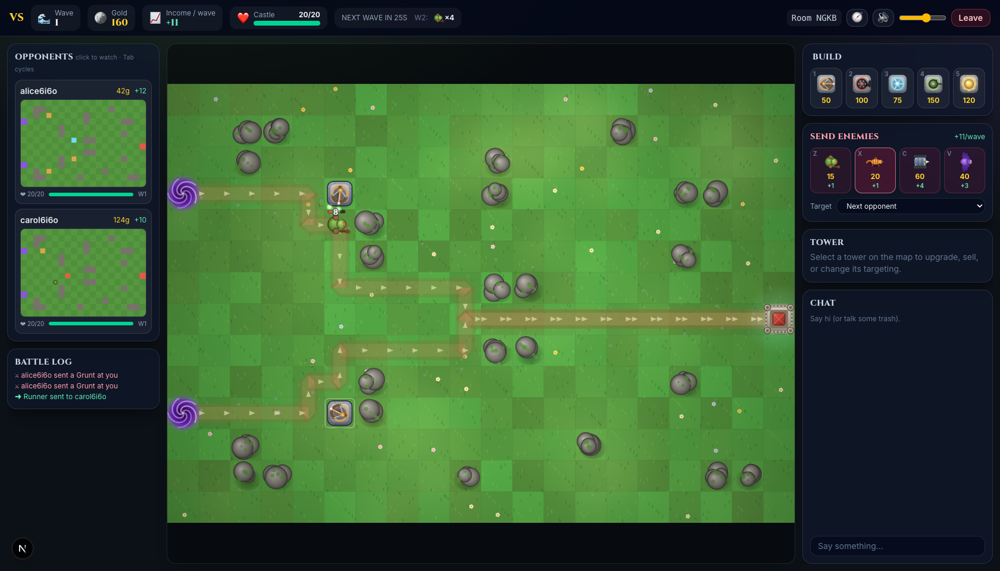
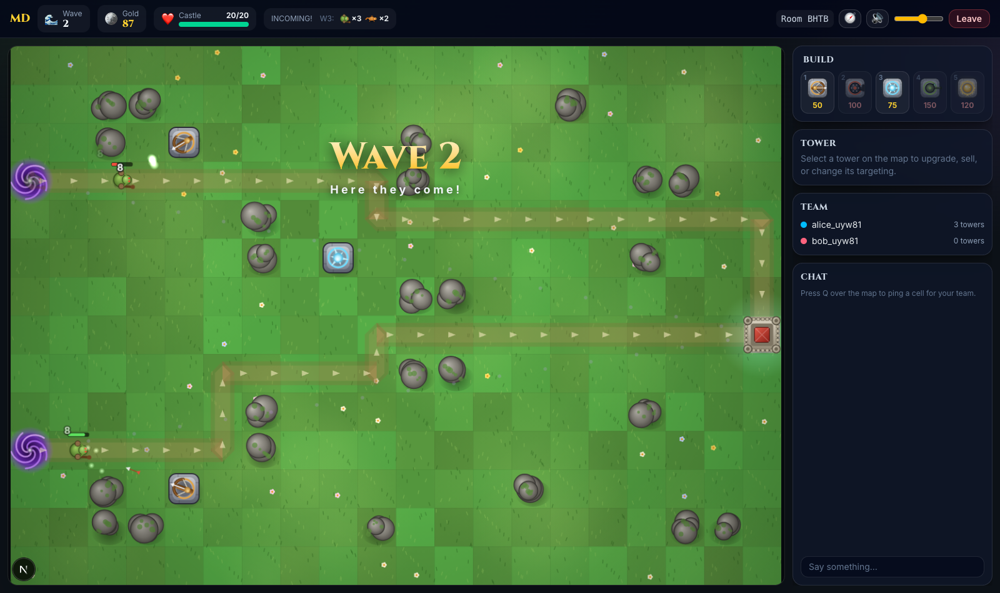
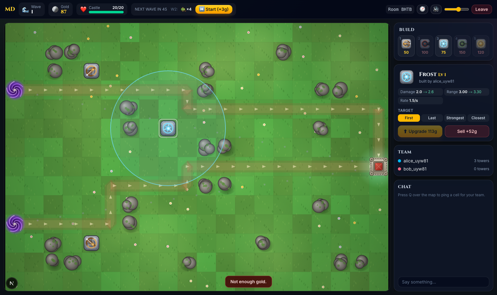
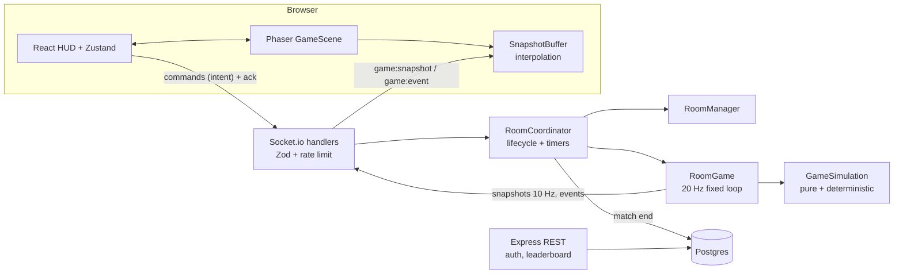

# Maze Defense

Versus tower defense for 2–4 players, plus a solo mode. Each player builds a maze on their own board: enemies always
take the shortest route to the castle, so every tower makes the path longer and deadlier. Spend gold to send enemies at
your rivals. Every send raises your income, so each wave is an attack-or-defend choice. The last castle standing wins.



| Wave in progress | Tower panel |
|---|---|
|  |  |

## Features

- **Versus (2–4 players):** identical seeded waves every 30 s; send grunts, runners, tanks and flyers at opponents;
  live mini-boards of every rival (click to watch); battle log; knock-outs and placements; ranked leaderboard.
  Rules: [docs/09-VERSUS.md](docs/09-VERSUS.md).
- **Solo:** 3 difficulties; clear wave 30 to win; best runs on the solo leaderboard.
- Accounts (JWT), rooms with 4-letter codes, ready-up with countdown, host force-start, spectators.
- A server-authoritative simulation at 20 Hz; clients get 10 Hz delta snapshots and interpolate 100 ms in the past.
- 9 towers (arrow, cannon, frost, sniper, support, laser, tesla, mine layer, barricade) with 4 levels, targeting modes,
  and a level-3 specialisation choice for every attacking tower.
- 8 enemies (grunt, runner, tank, flyer, healer, splitter, knight, boss). Wave generation is budget-based, with a
  boss every 10th wave that summons minions and enrages.
- Perks: pick 1 of 3 every 5 waves.
- 4 maps: Meadow, Canyon, Crossroads, Fortress.
- The client previews placements with the same flow field the server uses, so the ghost turns red before an invalid build.
- Procedural graphics: every sprite is drawn with Canvas 2D, so the game ships no image assets. Includes particles, screen
  shake, damage numbers, and animated path arrows.
- Synthesized WebAudio sound effects with volume and mute, remembered across visits.
- Reconnect: after a refresh you drop back into the same game. The game pauses if everyone disconnects, and a slot stays
  reserved for 60 s.
- Chat, solo and versus leaderboards, profiles, match history, and a game-over summary.

## Quick start

```bash
npm install
cp .env.example .env
npm run db:start      # embedded Postgres on :5432, no Docker needed (or: docker compose up -d)
npm run dev           # server :4000 + client :3000
```

Open http://localhost:3000 in two browsers and register two accounts. In one, create a **Versus** room; in the other,
join with the code. Or pick **Solo** to play alone right away.
Without a database the server falls back to an in-memory store: fine for a quick game, but accounts are lost on restart.

Controls: `1–9` pick a tower · click to build (shift-click keeps building) · click a tower to select · `U` upgrade · `S` sell ·
`Z`–`M` send grunt / runner / tank / flyer / healer / splitter / knight · `Tab` watch the next board · `Home` back to yours ·
`Space` (solo) start the wave early · `Esc` / right-click cancel.

## Architecture



| Package | Contents |
|---|---|
| `packages/shared` | Types, socket event constants, Zod schemas, balance config, maps, and the flow field |
| `packages/simulation` | `GameSimulation` plus systems (waves, movement, targeting, firing, projectiles, aura, economy) and the balance bot |
| `packages/server` | Express, Socket.io, RoomManager/RoomCoordinator, the game loop, Postgres repositories and migrations |
| `packages/client` | Next.js App Router pages, the Phaser scenes and procedural art, the HUD, and the stores |

Specs live in [`docs/`](docs/README.md); progress and measurements are in [`docs/08-PROGRESS-TRACKER.md`](docs/08-PROGRESS-TRACKER.md).

## Scripts

| Command | What it does |
|---|---|
| `npm run dev` | Server (tsx watch) and client (Next dev) |
| `npm test` | All Jest suites. The server's repository tests start an embedded Postgres unless `TEST_DATABASE_URL` is set |
| `npm run typecheck` / `npm run lint` | Strict TypeScript / ESLint |
| `npm run build` | Type-check, bundle the server (tsup), build the client (Next standalone) |
| `npm run balance -- --games 34` | Headless balance bot: strategies × games, reports the average wave reached |
| `npm run loadtest -- --rooms 25` | Socket.io load test against a running server |
| `npm run db:start` / `npm run db:migrate` | Embedded dev Postgres / apply migrations |
| `docker compose -f docker-compose.prod.yml up --build` | Full production stack behind Caddy |

Deployment: see [docs/DEPLOYMENT.md](docs/DEPLOYMENT.md).
